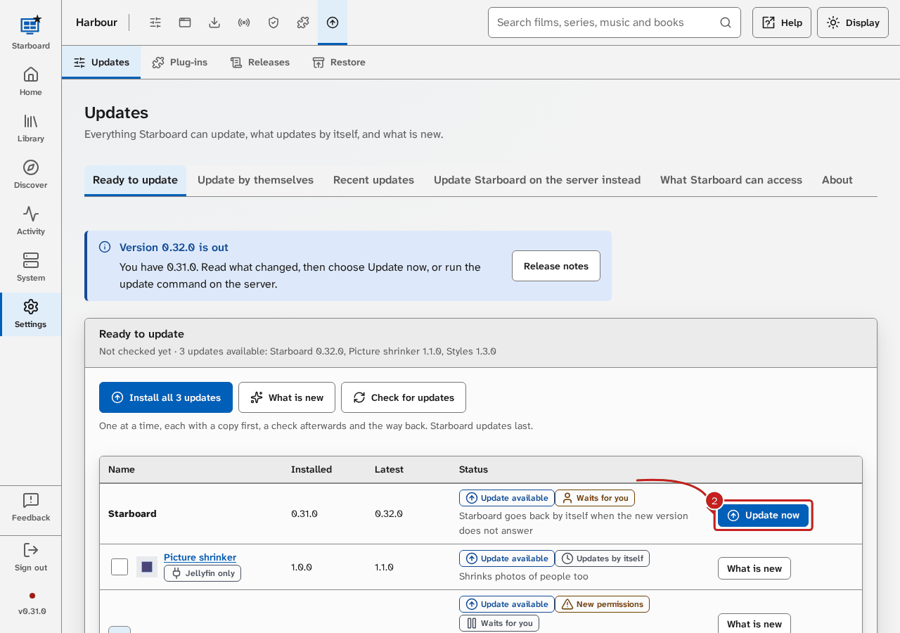
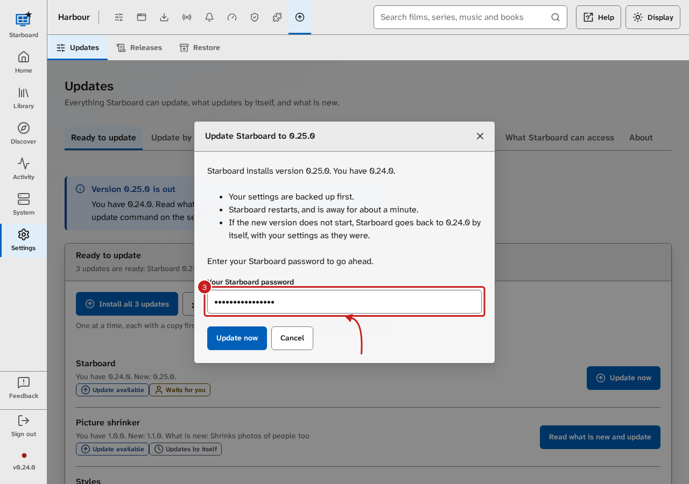
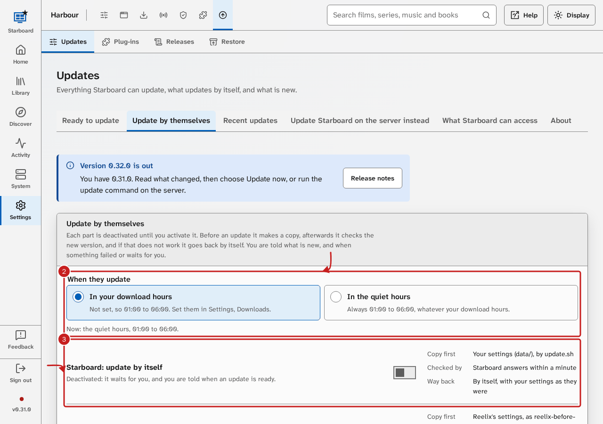
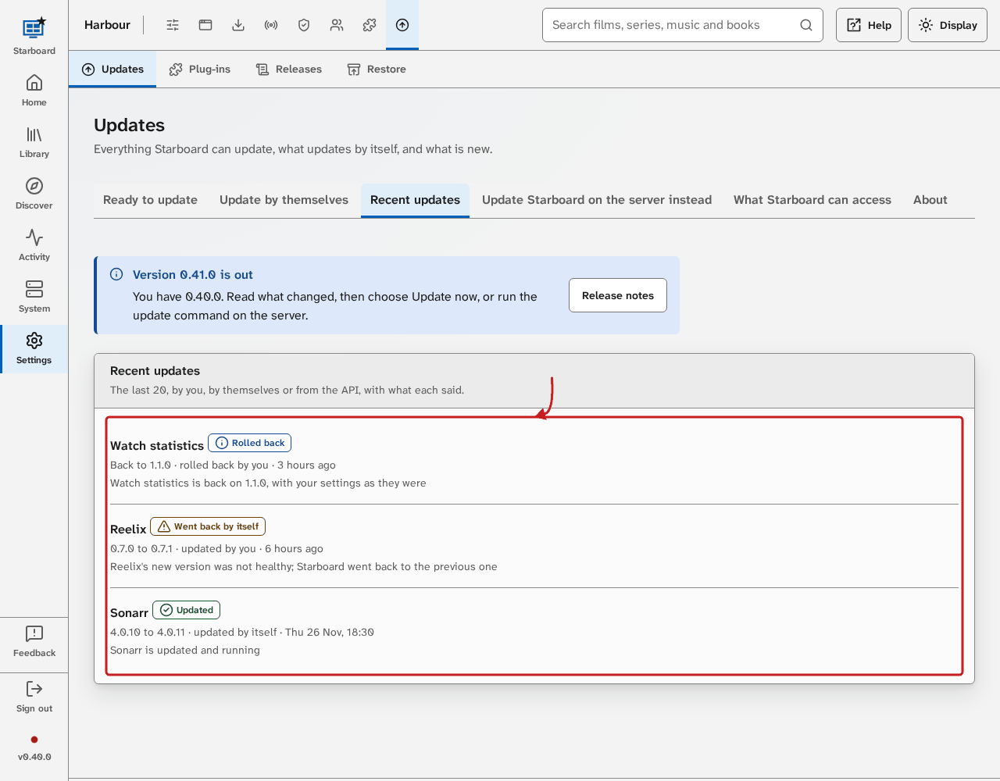

[Help centre](../README.md) · Install and update · how-to
<!-- help: use / updates -->

# Update Starboard

Update Starboard from its own page, with **Update now**, or let it update itself in the quiet hours. Either way it
backs up your settings, installs the newest release and goes back to the version you had if the new one does not
start. When several updates are waiting, **Install all updates** installs them all in one go. You can also run one
command on the server.

## Before you begin

- A terminal open on the server. Read [The terminal: typing commands](../basics/the-terminal.md).
- Know which way you installed Starboard: with the installer, or from the ready-made image. If your Starboard folder
  has a file called `update.sh`, you used the installer.

## Find out whether an update is out

- Starboard's version is at the foot of the side menu. When a newer one is out, a red dot appears just above it and
  pulses gently (it keeps still when **Reduce motion** is on). Select the version to go to **Settings**, then
  **Updates**. **About and updates** in the footer of any page goes there too.
- At the top of **Updates**, a notice says "Version 0.20.0 is out", for example, with a **Release notes** button that
  says what changed.

For this to work, **Check GitHub for new releases** must be activated. It is on the **Updates** page, under **Update
Starboard on the server instead**. What changed in every version is on **Settings**, then **Updates**, then
**Releases**.

## Update from Starboard's page

This works if you used the installer and Starboard has Docker access, or if you installed it without Docker.

1. Go to **Settings**, then **Updates**. The page opens on **Ready to update**. It lists Starboard, Reelix, each
   plug-in and Jellyfin's plug-ins, with the version you have, the new one and whether it waits for you or updates by
   itself.
2. Beside **Starboard**, select **Update now**.

   

3. A dialog says what happens: your settings are backed up first, Starboard restarts and is away for about a minute,
   and it goes back to your version by itself if the new one does not start. Enter **Your Starboard password** and
   select **Update now**.

   

4. A dialog shows each step with its state: checking, backing up, getting the new version, building it, restarting
   and checking that it answers. While Starboard restarts, the dialog loses touch for about a minute and reconnects
   by itself.
5. When it ends, it says **Starboard is updated**. Select **Done**, then **See what is new** to choose any new
   settings.

Closing the dialog does not stop the update. If **Update now** is not there, the page says why, such as a Starboard
from the ready-made image, which you update on the server.

## Install all updates at once

When more than one update is waiting, for Starboard, Reelix, your other apps or plug-ins, you can install them all
with one action. They still install one at a time, because that is safer on a small server: each one makes its copy
first, is checked afterwards and goes back by itself if it does not work, and the rest carry on.

1. Go to **Settings**, then **Updates**. At the top of **Ready to update**, select **Install all updates**. The
   button says how many are waiting, such as **Install all 6 updates**.
2. Enter **Your Starboard password** and select **Continue**. Starboard looks at each waiting update.
3. A dialog lists what will install, in the order it installs. Under **Held back for you**, it lists any update that
   always waits for you, with the reason:
   - a plug-in that asks for new permissions, or comes as a zip file: update it on its own page;
   - a big change, such as Radarr 5 to 6: read what is new first and update it on its own;
   - anything Starboard cannot update from here, such as an app that Docker Compose did not start.
4. Select **Install 4 updates**, for example.
5. A panel shows each update with its state: **Waiting**, **Updating**, **Done**, **Went back** or **Held back**, and
   how many have finished, such as "3 of 5". You can leave the page, and it carries on.
6. When it ends, the panel says how it went, such as "4 of 5 updated. Went back by itself: Sonarr".

The order is always the same:

1. Your other apps, then Jellyfin's plug-ins. Jellyfin installs its plug-ins but does not restart yet.
2. Starboard's plug-ins.
3. Reelix.
4. Jellyfin restarts once, for all its plug-ins. If someone is watching, it waits until nobody is, and the panel says
   so.
5. Starboard itself, last, because it restarts Starboard. The panel loses touch for about a minute and reconnects by
   itself.

**Recent updates** lists the whole batch as **All updates**, with each update under it.

## Let parts update by themselves

Starboard, Reelix, your other apps, Starboard plug-ins and Jellyfin's plug-ins can each update by themselves.

1. Go to **Settings**, then **Updates**, and select the **Update by themselves** tab.
2. Under **When they update**, choose **In your download hours** or **In the quiet hours** (always 01:00 to 06:00).
   Without download hours, both mean 01:00 to 06:00. The line under the choices says which hours are used now.
3. Activate the switch of each part you want, such as **Starboard: update by itself**. Each part is deactivated
   until you activate it. Beside each one, **Copy first**, **Checked by** and **Way back** say what is copied before
   the update, how the new version is checked and how it goes back if it does not work.

   

Each part backs up and checks in the same way as **Update now**, and you get an alert either way if alerts are
active. A version that did not install is not tried again by itself: **Update now** tries it again. Jellyfin's
plug-ins cannot go back by themselves, as Jellyfin keeps no older version. Read
[Updates for Reelix](update-your-apps.md#updates-for-reelix).

**Recent updates**, the next tab, lists the last 20 updates: by you, by themselves or from the API, with how each
ended, such as **Updated**, **Rolled back** or **Went back by itself**.



## Steps if you used the installer

You can update on the server instead, for example when Starboard does not open.

1. Go to the Starboard folder:

   ```bash
   cd ~/starboard
   ```

2. Run the updater:

   ```bash
   ./update.sh
   ```

   It shows "You have:" and "Available:" with two version numbers, then lists what changed. It backs up your
   settings, installs the new version and restarts Starboard.

3. Wait for the prompt to come back. The last line says "Updated to" and the new version.
4. Reload Starboard in your browser.

If you only want to know whether an update is out, without installing it, run `./update.sh --check`.

## Steps if you used the ready-made image

1. Go to the folder that holds `compose.image.yaml`:

   ```bash
   cd ~/starboard
   ```

2. Make a copy of your settings first, in case you need to go back. This saves the `data` folder in one file:

   ```bash
   tar -czf starboard-data-before-update.tar.gz data
   ```

3. Download the newest image:

   ```bash
   docker compose -f compose.image.yaml pull
   ```

4. Start Starboard again with the new image:

   ```bash
   docker compose -f compose.image.yaml up -d
   ```

5. Reload Starboard in your browser.

## After the update

- Select **Release notes** in the footer of any page to read what changed.
- If the new version brings settings to choose, a notice says "Starboard 0.15.5 is installed" and how many things
  there are to choose. Select **Choose now** to choose them in a slide-out over the page you are on, or
  **Open as a page**. It asks only the new questions. **Remind me later** in the slide-out leaves them for later.

## Things to note

- The updater keeps a backup of your `data` folder in the `backups` folder each time it runs, named with the date. It
  never sends anything anywhere.
- If the new version does not start, the updater goes back to the version you had and puts your settings back. The
  last lines say "Back on" and the version.
- If the `image:` line in your Compose file ends in a version, such as `:0.7.2` instead of `:latest`, pulling does not
  change it. Change the version in the file first. Read
  [Steps if you used the ready-made image](go-back-to-an-earlier-version.md#steps-if-you-used-the-ready-made-image)
  for how to edit it.
- To update your other apps, read [Update your apps](update-your-apps.md). To update a plug-in, read
  [Update a plug-in and roll it back](update-a-plugin.md).
- One update runs at a time, for Starboard, its apps and its plug-ins. **Install all updates** runs them one after
  another, in the order in [Install all updates at once](#install-all-updates-at-once).
- A script or an AI assistant can start an update, or install all updates, through Starboard's API, with a key that
  has **Updates** ticked. Read [Use Starboard's API](use-starboards-api.md).

## If it does not work

- **"Already up to date":** you have the newest release. Nothing changed.
- **It stops after "What changed", and nothing is updated:** versions up to 0.9.0 stop there when more than 30
  changes came since your version. Nothing has changed yet. In the Starboard folder, save a copy of your settings,
  then update by hand, with the version you want in place of `v0.9.0`:

  ```bash
  tar -czf backups/starboard-data-before-update.tar.gz data
  ```

  ```bash
  git checkout --quiet v0.9.0
  ```

  ```bash
  docker compose up -d --build
  ```

  Starboard is back within a minute. From the next version, `./update.sh` works again however much has changed.
- **"Stopped: files in this folder have been changed":** a file that came with Starboard was edited. Move any changes
  you want to keep somewhere else, then put the files back as they were with this command, and run `./update.sh` again:

  ```bash
  git checkout -- .
  ```

  Your settings are safe: they are in `data` and `.env`, which this does not touch.
- **"Stopped: this folder is not a git clone of Starboard":** you are in the wrong folder, or you used the ready-made
  image. Run `cd ~/starboard`, or follow the steps for the ready-made image.
- **"Starboard is still not starting":** read what went wrong with `docker compose logs starboard`, then read
  [Starboard does not open](starboard-does-not-open.md).

## Find out more

- [Go back to an earlier version](go-back-to-an-earlier-version.md)
- [Back up and restore Starboard's settings](back-up-settings.md)
- [Update your apps](update-your-apps.md)
- [Update a plug-in and roll it back](update-a-plugin.md)
- [Read the log and report a problem](read-the-log.md)

<!-- footer: download rights -->

---

**Download only what you have the right to.** Use the download apps only for files you have the right to download,
such as open-source software, works in the public domain and your own backups. Downloading films, series, music or
books without the copyright holder's permission is against the law in the UK and most other countries. Starboard
does not host or provide any files, and you are responsible for what you download.

<!-- /footer -->
