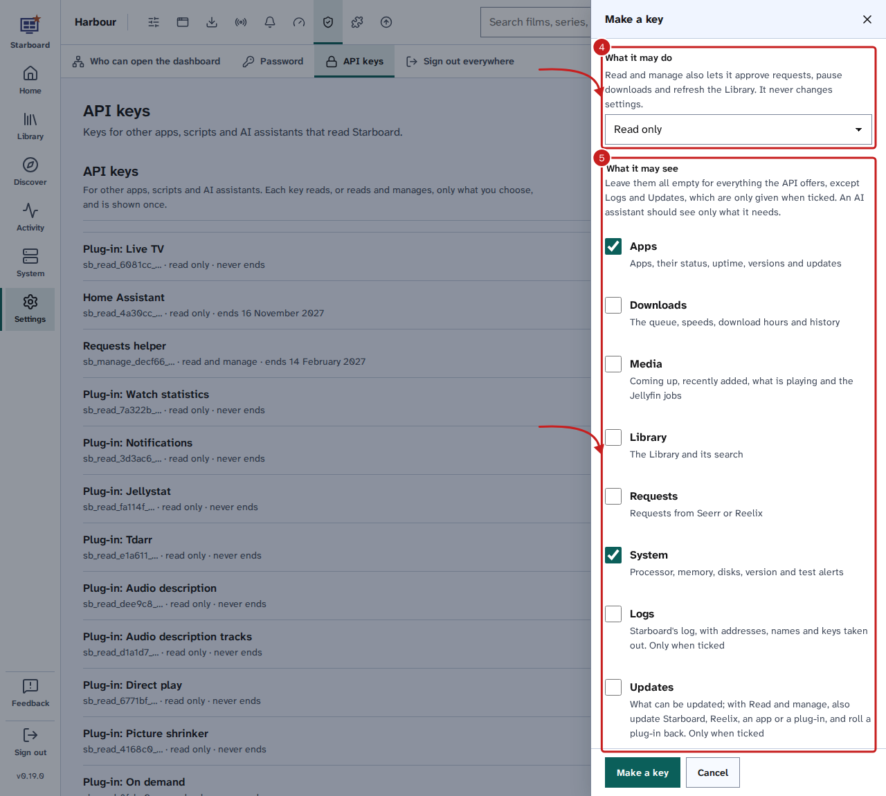
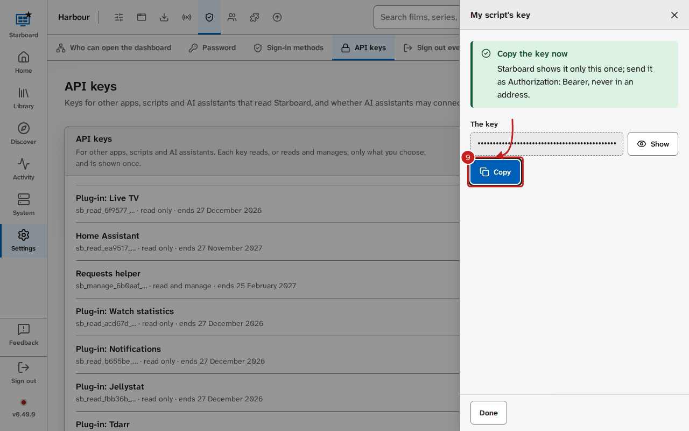
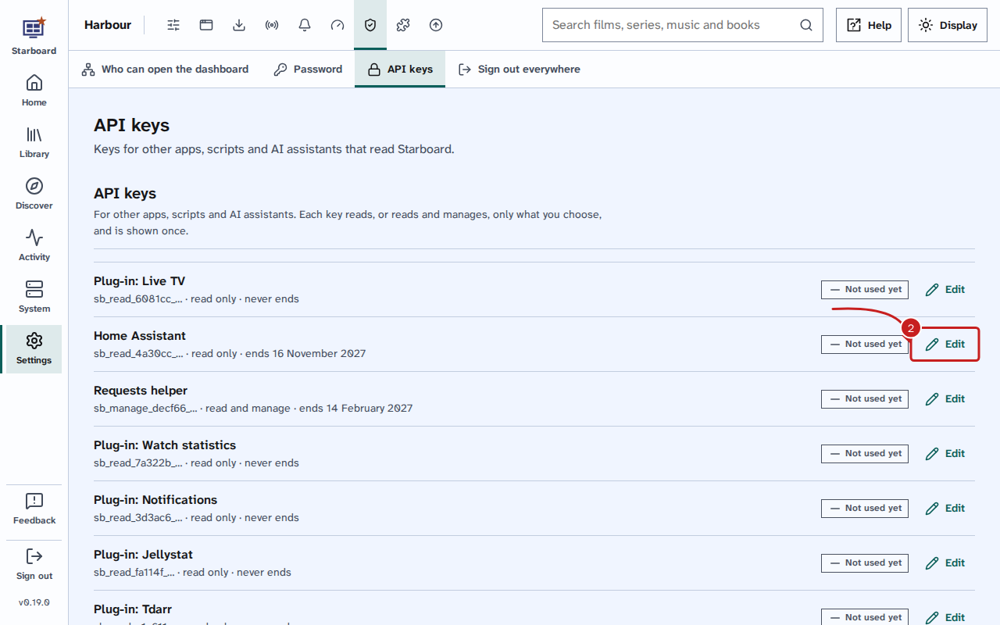
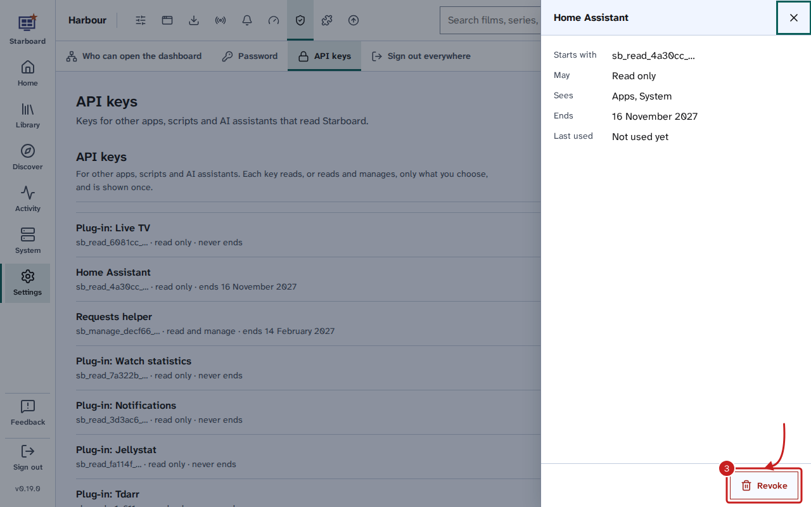

[Help centre](../README.md) · Security · how-to
<!-- help: dev / api -->

# Make an API key and use Starboard's API

Starboard's API lets other apps, scripts and AI assistants read what Starboard knows, such as your apps' status
and what is downloading. A key reads, or reads and manages: approves requests, pauses downloads and the like. No
key can change Starboard's settings. Make one key for each app that uses it.

## Before you begin

- Have your Starboard password ready.
- Know where the key will be used, such as Home Assistant, so you can name the key after it.

## Steps

### Make a key

1. Go to **Settings**, then **Security**, then **API keys**.
2. Select **Make a key**. A slide-out opens.
3. In **Name it after what will use it**, enter a name, such as `Home Assistant`.
4. In **What it may do**, choose **Read only**, or **Read and manage** if it must act, such as approving requests.
5. In **What it may read**, tick only the areas it needs. Leave them all empty for everything except **Logs** and
   **Updates**, which a key has only when they are ticked. **Updates** with **Read and manage** lets it update
   Starboard, Reelix, your apps and plug-ins, and roll a plug-in back, as the pages do.

   

6. In **Ends**, choose **In 90 days**, **In a year** or **Never**.
7. In **Your Starboard password**, enter the password.
8. Select **Make a key**.
9. Select **Copy**, then paste the key into the app that will use it. The key is hidden until you select
   **Show**. Starboard shows the key only this once. Select **Done**.

   

The key appears in the list with its name, the start of the key, what it may do, when it ends and whether it has
been used.

### Use the key

Send the key in the `Authorization` header, as `Bearer` and then the key. For example, from the server:

```bash
curl -H "Authorization: Bearer sb_read_..." http://127.0.0.1:8095/api/v1/status
```

Every address starts with `/api/v1`. A key reads your apps and their status, problems the apps report,
downloads, Coming up, requests, the Library, recently added media, what is playing in Jellyfin, and the server's
processor, memory and disks, within the areas you ticked.

### Revoke a key

1. Go to **Settings**, then **Security**, then **API keys**.
2. Select **Edit** beside the key.

   

3. The slide-out shows what the key **May** do, what it **Reads** and when it ends. Select **Revoke**, then **Revoke**
   again to confirm. Anything using the key stops working at once.

   

## Things to note

- The full list of what the API offers is in **the API description (OpenAPI)**, under **API keys**. It is also
  at `/api/v1/openapi.json` on your Starboard.
- A key in the address is refused. Send it only in the header.
- Each key can make up to 120 requests a minute.
- Changing the password or [signing out everywhere](sign-out-everywhere.md) does not stop a key. Revoke it.
- No key can change network access, the sign-in cookie, how long sign-ins last or where alerts go. Read
  [How Starboard keeps your server safe](../basics/how-starboard-keeps-you-safe.md).

## If it does not work

- **key_needed:** the key is missing, wrong, revoked or past its end date. Make a new key.
- **too_many_attempts:** too many wrong keys came from that address. Wait 15 minutes.
- **rate_limited:** more than 120 requests in a minute. Wait the seconds the answer gives.
- The [list of API errors](https://github.com/TheMightyTRex/starboard/blob/main/docs/api/errors.md) explains
  each one.

## Find out more

- [How Starboard keeps your server safe](../basics/how-starboard-keeps-you-safe.md)
- [Choose who can open Starboard](choose-who-can-open-starboard.md)
- [Use Starboard away from home safely](../guides/use-starboard-away-from-home.md)

<!-- footer: download rights -->

---

**Download only what you have the right to.** Use the download apps only for files you have the right to download,
such as open-source software, works in the public domain and your own backups. Downloading films, series, music or
books without the copyright holder's permission is against the law in the UK and most other countries. Starboard
does not host or provide any files, and you are responsible for what you download.

<!-- /footer -->
