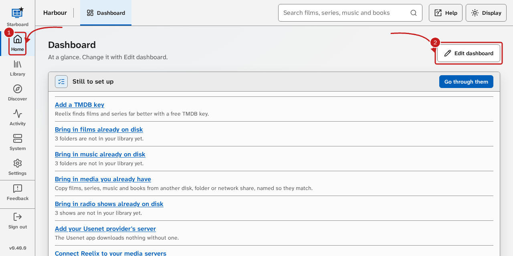
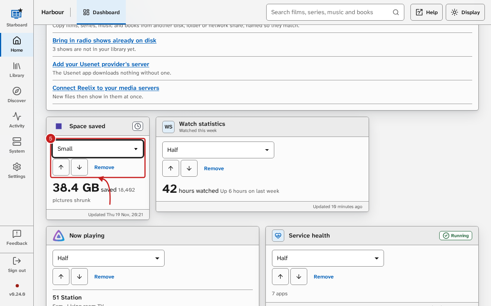
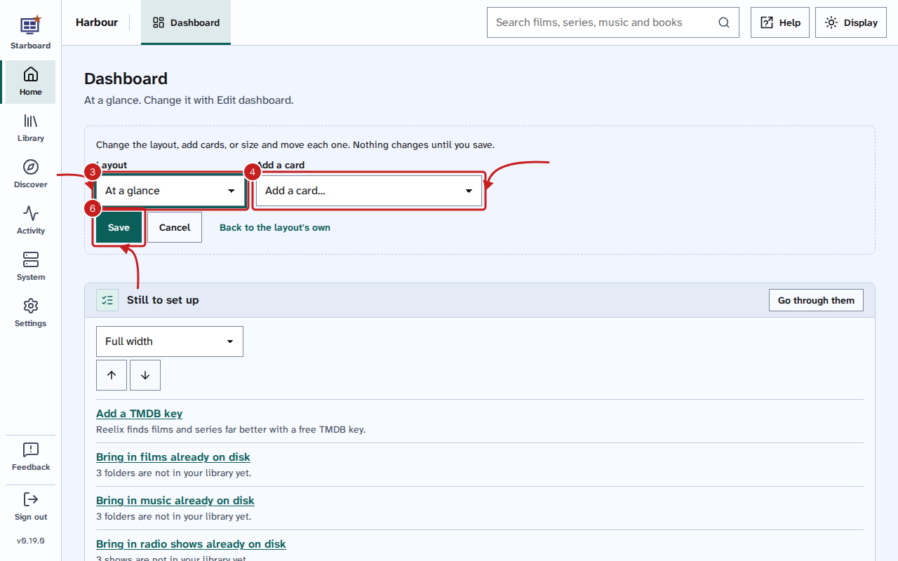
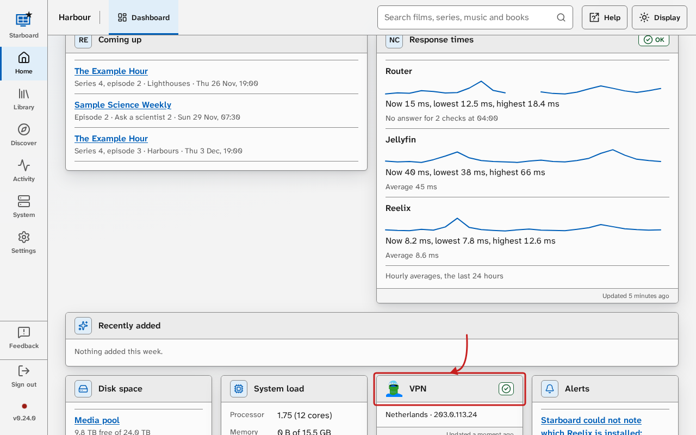

[Help centre](../README.md) · Everyday use · how-to
<!-- help: use / dashboard -->

# Use and change the dashboard

The dashboard is the first page after you sign in. It shows your server at a glance, as cards in one of
four layouts. You can choose another layout, add and remove cards, and change each card's size and place.

## Before you begin

- Most cards need an app with its API key, such as Jellyfin for **Now playing**. Read
  [Find an app's API key](find-an-api-key.md).

## Steps

### Change the dashboard

1. Go to **Home**, then **Dashboard**.
2. Select **Edit dashboard**. Nothing changes until you save.

   

3. Optional: in **Layout**, choose **At a glance**, **Watch and listen**, **Downloads and storage** or
   **Compact**. The cards change to that layout's own.
4. Optional: in **Add a card**, choose a card from **Add a card…**. It is added at the end, at **Half** size.
5. Optional: change a card with the controls under its band:
   - Choose its size: **Small**, **Medium**, **Half**, **Wide** or **Full width**. Some plug-in cards have a
     shorter title at a smaller size, such as **Space saved** for Picture shrinker's **Pictures: space saved**.
   - Select the up or down arrow to move it earlier or later.
   - Select **Remove** to take it off the dashboard.

   

6. Select **Save**. Starboard confirms with **Dashboard saved**.

   

To start again, select **Back to the layout's own**, then **Save**. To leave without changing anything, select
**Cancel**.

### Add a plug-in's card

Some plug-ins add a card, such as Live TV. The plug-in must be added and active. Read
[Add a plug-in](add-a-plugin.md).

1. Select **Edit dashboard**.
2. In **Add a card**, choose the card. Its name ends with the plug-in's name in brackets, such as
   **Live TV (Live TV)**.
3. Select **Save**.

## The cards

- **Still to set up:** what is left to set up. Read [Finish what is still to set up](finish-setting-up.md).
- **Now playing:** what people are watching in Jellyfin.
- **Downloads:** the first few downloads, with how far along they are.
- **Coming up:** what is due in the next days. Read [Find out what is coming up](coming-up.md).
- **Recently added:** what came into your library this week.
- **Disk space**, **System load** and **Transfer speed:** free space, processor and memory, and download speeds.
- **VPN:** whether your VPN is connected, and its country. Without one, it says **No VPN**, with **Add a VPN**.
- **Service health:** how many apps are running, and which are not responding.
- **Requests:** what is waiting for approval. Read [Approve or decline requests](approve-requests.md).
- **Alerts:** the last few problems in the logs.
- **Quick links:** a button for each of your apps.

Each card has a grey band across the top with a logo and the card's name. A card about one app shows that app's
logo, such as Jellyfin's on **Now playing**. A plug-in's card shows the plug-in's logo, or its initials, such as
**WS** for Watch statistics. Starboard's own cards, and cards that combine several apps, show a Starboard icon. At
the right of the band, a status and when the card was updated show when the card has something to say, such as
**Nearly full** on **Disk space**. A small card shows only the status's icon, so the band stays on one line.
**Still to set up** has **Go through them** at the right of its band.

## Things to note

- Your choice is saved to your account, so the dashboard is the same on each device you sign in from.
- **Still to set up** stays first while anything is left to set up, and cannot be removed. It goes by itself
  when everything is done.
- Cards update once a minute while the page is in view. A hidden tab asks for nothing.
- A plug-in's card says **Its plug-in is not active.** when you deactivate the plug-in.

## Find out more

- [Finish what is still to set up](finish-setting-up.md)
- [Set up your dashboard after installing](../guides/set-up-your-dashboard.md)
- [Choose a design for the Apps page](choose-a-design.md)

<!-- footer: download rights -->

---

**Download only what you have the right to.** Use the download apps only for files you have the right to download.
Examples are open-source software, works in the public domain and your own backups. Downloading films, series, music or
books without the copyright holder's permission is against the law in the UK and most other countries. Starboard
does not host or provide any files, and you are responsible for what you download.

**Need help?** Ask on the [Starboard Discord support server](https://discord.gg/xN9bf2H4vv).

<!-- /footer -->
