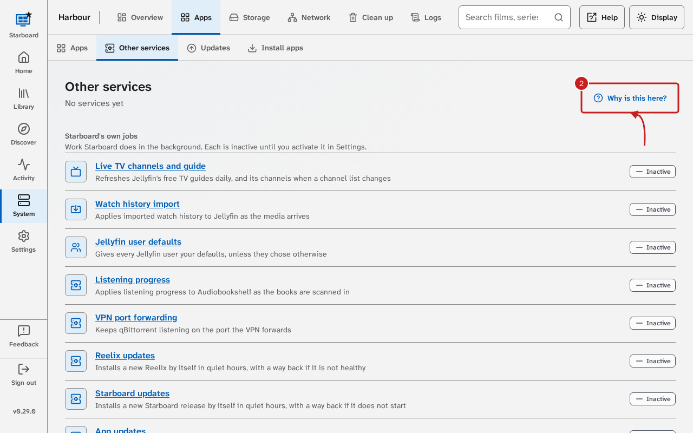
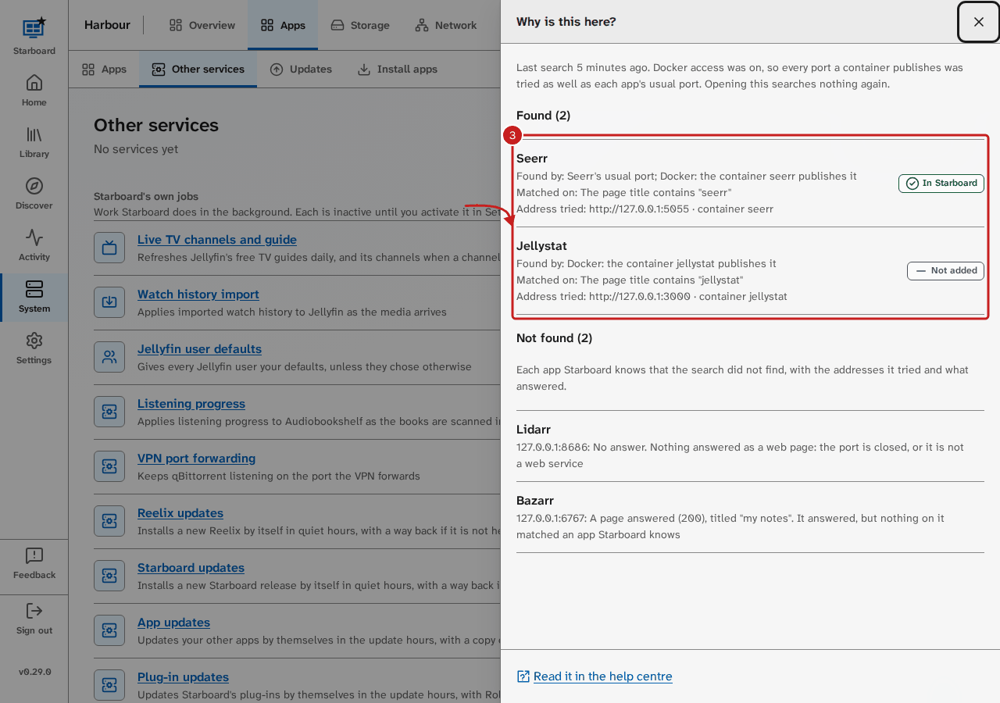
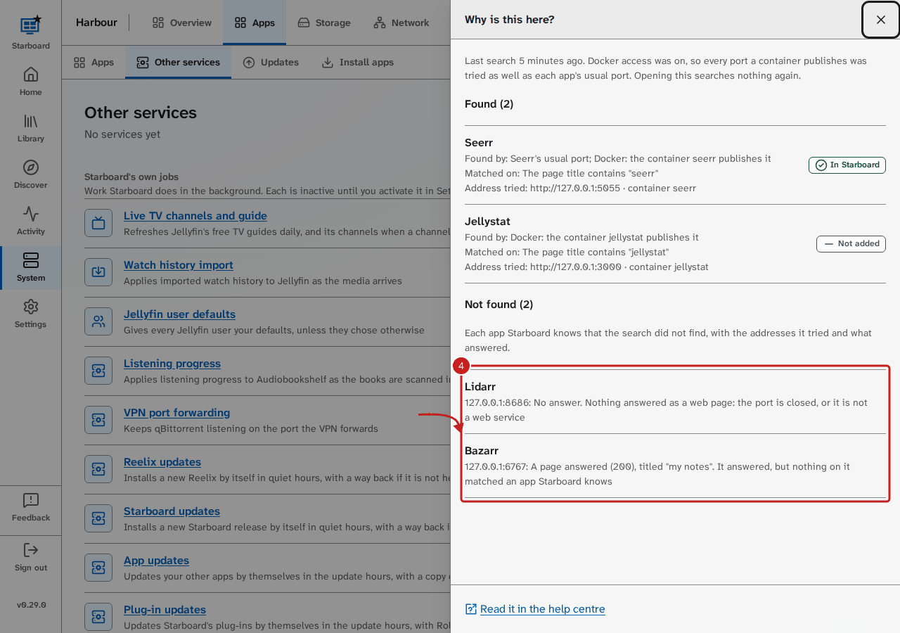

[Help centre](../README.md) · Apps · how-to
<!-- help: use / apps -->

# Find out why an app is here, or why one was not found

When Starboard searches for apps on your server, it does not guess. For each app it found, it can tell you
what found it and what it matched on. For each app it did not find, it can tell you which address it tried and
what answered. This helps when an app turns up that you did not expect, or when one you run is missing.

## Before you begin

- You have searched for apps at least once, with **Search for new apps** in
  [Search for apps already on your server](search-for-new-apps.md). Until then there is nothing to explain.

## Steps

1. Go to **System**, then **Apps**, then **Other services**.
2. Select **Why is this here?**. A side panel opens.

   

3. Read **Found**. Each app has three lines: **Found by** says what led Starboard to it (the app's usual port, or
   a Docker container that publishes a port), **Matched on** says what it recognised it by (a page title, or a
   status address that answered), and **Address tried** gives the address. A label at the end of the row says whether the
   app is already in Starboard.

   

4. Read **Not found**. Each app Starboard knows but did not find has a line for each address it tried, with what
   answered and why that was not a match. **No answer** means nothing answered as a web page: the app is not
   running, or it uses another port. An answer that matched nothing means something else is on that port.

   

5. Press <kbd>Escape</kbd> or select **Close** to leave the panel. Focus goes back to **Why is this here?**.

## Things to note

- Opening the panel searches nothing again. It shows what the last search already learned, which Starboard keeps in
  a small file, so it is still there after a restart. To search again, use
  [Search for apps already on your server](search-for-new-apps.md).
- Starboard finds apps in two ways only: it tries each app's usual port, and, with Docker access, every port a
  container publishes. It does not read links or plug-ins to find apps.
- The panel names only apps on this computer. Apps you added by hand, on other computers, are not part of the search.
- If it says Docker access was off, only the usual ports were tried. Read
  [Change what Starboard can access](change-what-starboard-can-access.md) to give Starboard that access.

## Find out more

- [Search for apps already on your server](search-for-new-apps.md)
- [Add an app](add-an-app.md)
- [Find an app's API key](find-an-api-key.md)

<!-- footer: download rights -->

---

**Download only what you have the right to.** Use the download apps only for files you have the right to download,
such as open-source software, works in the public domain and your own backups. Downloading films, series, music or
books without the copyright holder's permission is against the law in the UK and most other countries. Starboard
does not host or provide any files, and you are responsible for what you download.

**Need help?** Ask on the [Starboard Discord support server](https://discord.gg/xN9bf2H4vv).

<!-- /footer -->
